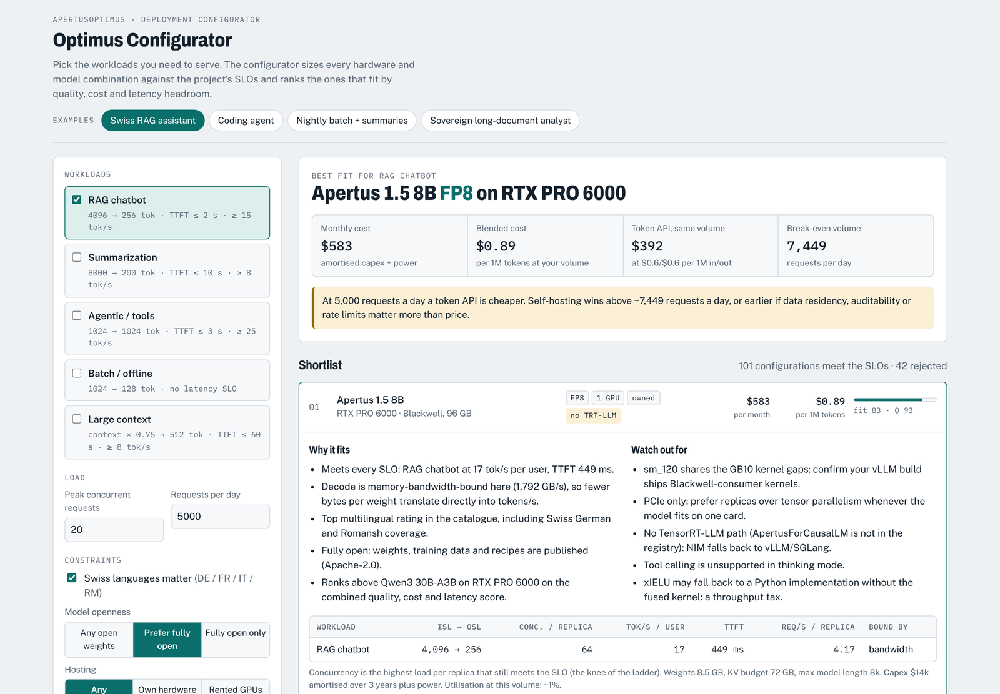
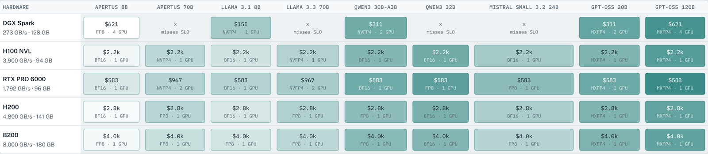

# Optimus Configurator

Which hardware and LLM fit your use case, and when does self-hosting beat a token API?

Pick the workloads you need (RAG chatbot, summarization, agentic / tool use, batch, large context), enter the expected load and your constraints, and the configurator sizes every **hardware × model × precision** combination against latency targets and ranks the ones that fit by quality, cost and latency headroom.

**Live:** https://nanocoach.org



It grew out of the *ApertusOptimus* project (Swiss AI Weeks, HPE & NVIDIA Agentic AI Hackathon), where we served the Swiss open model **Apertus 1.5** on a DGX Spark and on 2× H100 NVL and turned the measurements into cost per token.

## What you get

- **Best fit** with monthly cost, blended cost per 1M tokens, the same volume on a token API, and the **break-even** volume in requests per day.
- **Shortlist** of up to six configurations. Each explains why it fits, what to watch out for (lessons from our tests), per-workload numbers (concurrency per replica, tokens/s per user, time to first token) and a **vLLM start command**.
- **Fit matrix** of every hardware × model pair, with the reason each rejected pair fails.
- **Editable assumptions** (GPU prices, capex, electricity, API prices) and a **calibration** box for pasting measured benchmark results.



## Catalogue

| Hardware | Models | Precisions |
|---|---|---|
| DGX Spark (GB10), H100 NVL, RTX PRO 6000 Blackwell, H200, B200 | Apertus 1.5 8B / 70B, Llama 3.1 8B, Llama 3.3 70B, Qwen3 30B-A3B, Qwen3 32B, Mistral Small 3.2 24B, gpt-oss 20B / 120B | BF16, FP8, 4-bit (NVFP4 / W4A16), MXFP4 |

## How it estimates

Speed comes from first principles: a decode step is limited by memory bandwidth (weights plus KV cache read per token) or compute, prefill is compute-bound including the quadratic attention term, and the two share the GPU. Concurrency climbs until the latency target breaks. The estimates reproduce our DGX Spark measurements (Apertus 8B BF16 ≈ 13 tok/s, NVFP4 ≈ 24 tok/s). Full method: [docs/DESIGN.md](docs/DESIGN.md).

> **Caveats.** Prices are placeholders and must be verified before quoting a number. Model quality ratings are indicative judgements for ranking, not benchmark scores.

## Run locally

No build step, no dependencies, no backend.

```bash
python3 -m http.server 8080      # then open http://localhost:8080
```

## Test

The estimation engine also runs under Node (≥ 18):

```bash
npm test                         # = node --test test/engine.test.js
```

## Deploy

Copy the folder to any static web server. Step-by-step for Ubuntu + nginx + Let's Encrypt: [docs/DEPLOY.md](docs/DEPLOY.md).

## Layout

```
index.html          page markup
css/style.css       styles (light + dark theme)
js/engine.js        catalogue, speed model, sizing, ranking (browser + Node)
js/app.js           UI: inputs, shortlist, fit matrix, assumptions, calibration
test/               engine tests (npm test)
docs/DESIGN.md      inputs, workload shapes, estimation model, scoring
docs/DEPLOY.md      nginx + certbot deployment
```

To change defaults, edit `HW`, `MODELS` and `DEFAULT_ASSUMPTIONS` at the top of `js/engine.js`.
